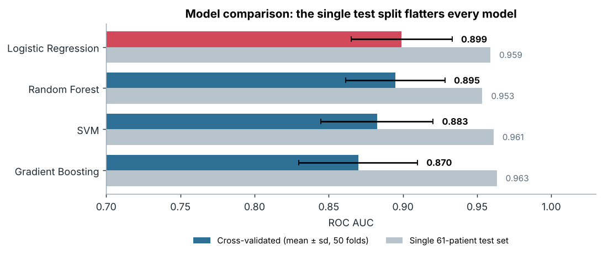
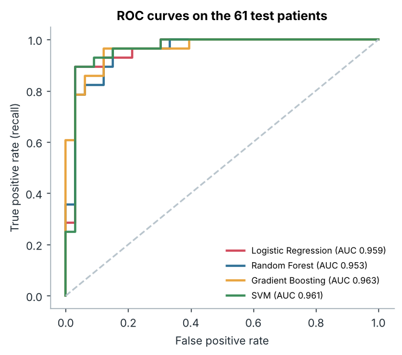
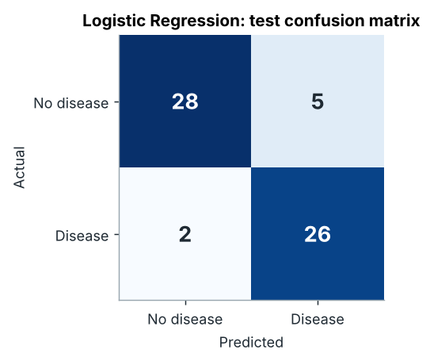
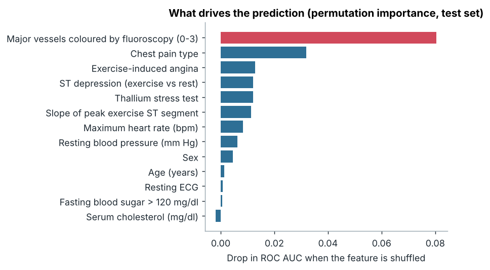
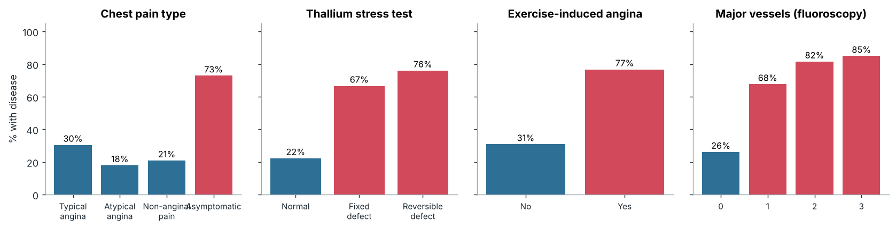
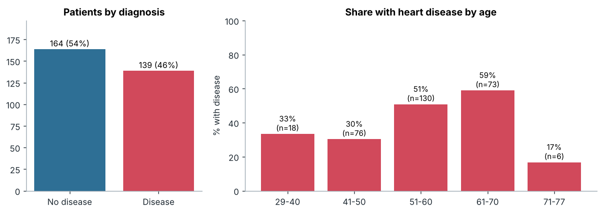

# ❤️ Heart Disease Risk Prediction

Predicting whether a patient has heart disease from 13 clinical measurements (UCI Cleveland data, 303 patients) with scikit-learn, plus a **Streamlit app** for single-patient estimates.

The selected model, **logistic regression**, reaches a **cross-validated ROC AUC of 0.899 ± 0.034**. On the 61-patient test set it scores 0.959 and catches **26 of 28** patients with disease, but that single split is optimistic: repeated cross-validation is the number to trust.



---

## Results

Train/test split: 242 / 61 patients (stratified, `random_state=42`). Every model is compared with **5-fold cross-validation repeated 10 times on the training set**, then scored once on the test set.

| Model | CV ROC AUC (mean ± sd) | Test ROC AUC | Test recall | Test specificity |
|---|---:|---:|---:|---:|
| Baseline (disease rate) | 0.500 | 0.500 | 0.000 | 1.000 |
| **Logistic Regression** | **0.899 ± 0.034** | 0.959 | 0.929 | 0.848 |
| Random Forest | 0.895 ± 0.033 | 0.953 | 0.929 | 0.848 |
| SVM (RBF) | 0.883 ± 0.038 | 0.961 | 0.929 | 0.848 |
| Gradient Boosting | 0.870 ± 0.040 | 0.963 | 0.929 | 0.879 |

**Why logistic regression wins.** With 242 training patients, the simplest model generalises best; the tree ensembles and SVM look as good or better on the one test split but lose under repeated cross-validation. All four models differ by less than one standard deviation, so the choice also favours the model a clinician can read.

<p align="center">
  
  
</p>

High recall matters most here: a missed patient costs more than a false alarm. At the default 50% threshold the test set has 2 missed patients and 5 false alarms; across all 303 patients with out-of-fold predictions, recall is lower (79%), see the [model card](MODEL_CARD.md).
All numbers are in [`reports/metrics.json`](reports/metrics.json).

### What drives the prediction?



The number of **major vessels seen on fluoroscopy** is the strongest signal, followed by **chest pain type**, **exercise-induced angina**, **ST depression** and the **thallium stress test**. Cholesterol and fasting blood sugar add almost nothing.



Patients with **asymptomatic** chest pain have the highest disease rate (73%), which looks counter-intuitive but is a known feature of this dataset: they were referred for testing for other reasons.

---

## Data

[UCI Heart Disease, Cleveland file](https://archive.ics.uci.edu/dataset/45/heart+disease): 303 patients, 46% with disease (diagnosis 1–4 grouped as "disease"). See [`data/README.md`](data/README.md) for every column and code.



**Data validation** (`src/heart_disease/validate.py`) runs before every training run and stops it on errors (missing columns, invalid diagnosis). It found 4 missing values in `ca` and 2 in `thal` (imputed inside the pipeline), no duplicates, all values inside clinical ranges and every category code known. The app checks each entered patient the same way. Report: [`reports/data_validation.json`](reports/data_validation.json).

---

## Project structure

```
├── data/heart_disease.data          # UCI Cleveland data (+ data/README.md)
├── notebooks/                       # original exploration: preprocessing, PCA, feature selection,
│                                    # supervised and unsupervised models, tuning
├── src/heart_disease/
│   ├── config.py      # paths, feature lists, code labels
│   ├── data.py        # loading + binary target
│   ├── validate.py    # data validation (training file + app inputs)
│   ├── models.py      # leak-free pipelines: baseline, LR, RF, GB, SVM
│   ├── evaluate.py    # AUC, recall, specificity, Brier score
│   ├── plots.py       # README figures
│   ├── train.py       # validate, cross-validate, test, save the best model
│   └── predict.py     # CLI and helper used by the app
├── app.py                           # Streamlit app
├── reports/                         # figures, metrics.json, model_comparison.csv
├── tests/                           # pytest
└── MODEL_CARD.md                    # intended use, performance by group, limitations
```

## Quick start

```bash
git clone https://github.com/YoussefSaeed1/Heart_Disease_Project.git
cd Heart_Disease_Project
pip install -r requirements.txt
pip install -e .

python -m heart_disease.train          # validate, compare models, save the best to models/
python -m heart_disease.predict --json '{"age": 58, "sex": 1, "cp": 4, "trestbps": 140, "chol": 260, "fbs": 0,
  "restecg": 2, "thalach": 130, "exang": 1, "oldpeak": 2.0, "slope": 2, "ca": 2, "thal": 7}'
streamlit run app.py                   # trains the model on first run if it is missing
pytest
```

## Changes from the first version

The notebooks are kept in `notebooks/` as the original exploration. The rebuild fixes what they got wrong:

- **Feature types came from pandas, not from the data dictionary.** Chest pain type, resting ECG and slope were scaled as numbers, while `ca` and `thal` were one-hot encoded only because a `?` made them text columns. Numeric and coded features are now listed explicitly, and missing values are read as missing.
- **Feature selection used all 303 patients.** RFE and chi-square in the notebooks were fitted before any split; they were only used for discussion, so they stay in the notebooks but nothing in the pipeline depends on them.
- **One 61-patient test set picked the winner.** It made Random Forest look best (AUC 0.958). Repeated cross-validation shows the models are close, with logistic regression slightly ahead.
- **The app accepted wrong codes.** Chest pain was offered as 0–3 and thal/slope as 0–3, but the data uses 1–4, 3/6/7 and 1–3. The app now shows labelled choices with the real codes and warns on unusual values.
- **Hard-coded local paths** (`C:\Users\...`) and a committed model file were replaced by a package that rebuilds the model.

> This project is for learning purposes only and is not a medical diagnostic tool.

---

By **[Youssef Saeed](https://youssefsaeed-portfolio.vercel.app/)** · [LinkedIn](https://www.linkedin.com/in/youssef-saeed1/) · License: MIT
